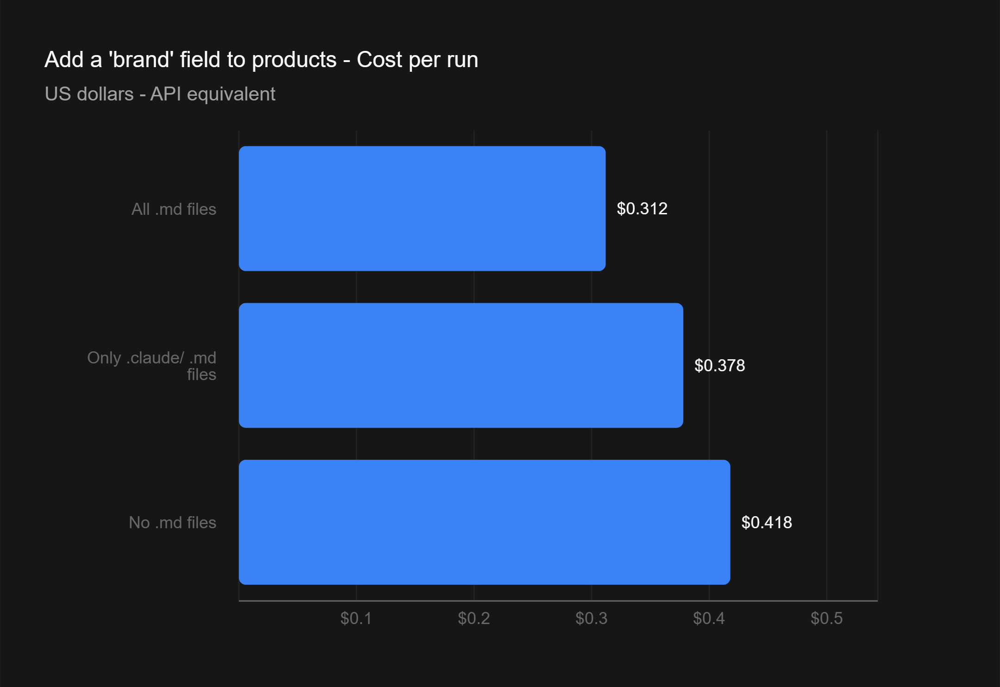
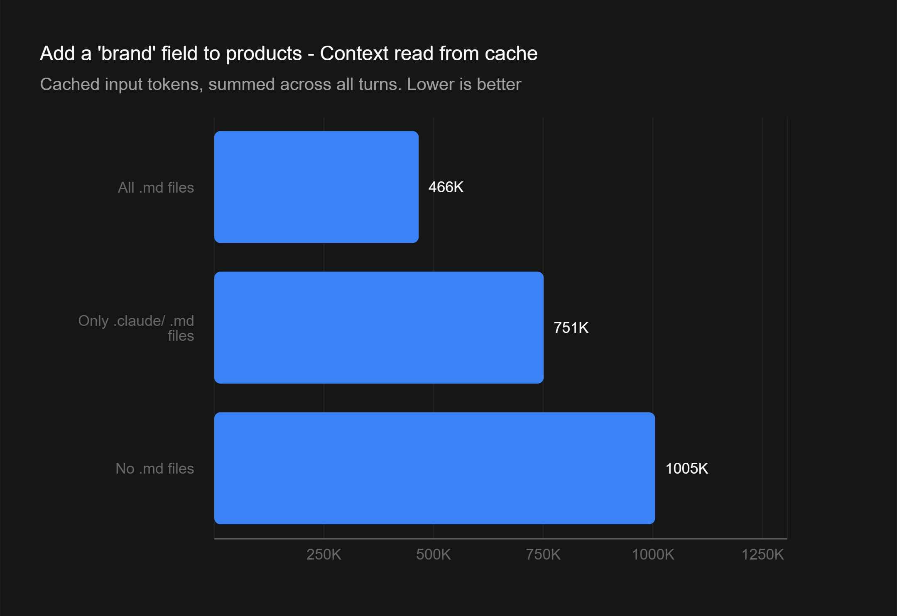
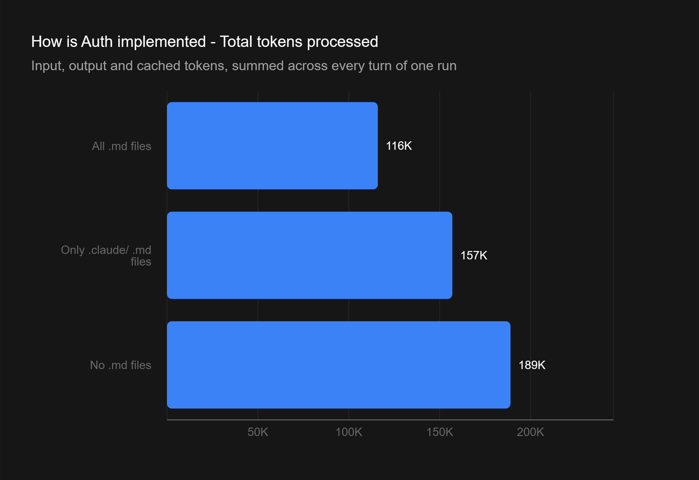

# Metra

Metra is a demo ERP for small retail businesses. It is deliberately small, but it is built the way a real ERP
should be.

## Goals

1. **Apply good ERP practices, even in a low-complexity system.** The functionality is only a base for the second
   goal, so the focus is on how it is built:
   - **Module organization:** clean layers on the API (domain, application, infrastructure, endpoints) and one
     folder per feature on the front end, with a reference module that new ones copy.
   - **Tests:** unit tests for domain rules, integration tests against a real MySQL, and front-end component tests.
   - **Performance:** server-side pagination, filtering and sorting, with every new index checked with `EXPLAIN`
     against a seed of 100 thousand products and 1 million stock movements.
   - **Data integrity:** stock movements and financial entries are never deleted, balances are updated
     transactionally, numbering is sequential without gaps, and edits use optimistic concurrency.
   - **Contracts and access:** an OpenAPI contract with a generated client, role-based authorization, and business
     rules documented per module.
2. **Measure how much Markdown context files affect Claude Code.** The repository carries project context as
   Markdown (`CLAUDE.md`, rules, skills and module docs). A goal of the project is to measure how those files change
   token usage and the speed with which Claude Code makes changes and improvements. The plan is to branch from the
   same commit, remove or restore the context files per scenario, and repeat the same tasks at least three times,
   recording model versions, prompts and results (see `docs/plan.md`).

## Stack

| Layer | Technologies |
| --- | --- |
| Front end | Angular 22, Signal Forms, Spartan UI, Tailwind CSS v4, Lucide icons |
| API | .NET 10 (Minimal APIs), EF Core, OpenAPI with a generated TypeScript client |
| Database | MySQL 9.7 |
| Runtime | Docker Compose |

## Run

```sh
git clone https://github.com/LauroSeibert/metra.git && cd metra
cp .env.example .env   # fill in the passwords
docker compose up -d --build
dotnet run --project backend/src/Erp.Seed -- seed --profile small   # sample data (optional)
```

- Front end: http://localhost:8080 (sign in with `ADMIN_EMAIL`/`ADMIN_PASSWORD` from `.env`)
- API: http://localhost:5080 (`/health`, `/health/ready`)
- The Docker Compose project is named `metra` (containers `metra-*`, volumes `metra_mysql-data` and `metra_api-keys`).

## Develop

```sh
dotnet build backend/Erp.slnx                  # API
dotnet test --solution backend/Erp.slnx        # tests (need Docker)
cd frontend && npm start                       # front end in dev mode (proxies to the API)
cd frontend && npm run build && npm run lint && npm test
cd frontend && npm run api:generate            # regenerate the OpenAPI client after changing the API
```

## Context for the AI

The project's instructions and docs are written in Brazilian Portuguese, and so is the user interface. Code is in
English. Everything below is plain Markdown (or a small script) that Claude Code loads on demand:

| File | Purpose |
| --- | --- |
| `CLAUDE.md`, `backend/CLAUDE.md`, `frontend/CLAUDE.md` | project map, commands, global rules and pitfalls (the root file is always loaded; the others load when working in their folder) |
| `.claude/rules/*.md` | rules by topic (API endpoints, database, front end), loaded only for the paths they apply to |
| `.claude/skills/` | step-by-step recipes: new endpoint and new screen, both following the reference module (products) |
| `.claude/settings.json` + `.claude/hooks/` | hooks that block edits to generated files (the OpenAPI client) and format front-end files after each edit |
| `docs/plan.md` | the plan, the phases and the experiment protocol (see "Escopo simplificado") |
| `docs/architecture.md`, `docs/api-conventions.md` | layers and dependencies; how endpoints, errors, pagination and sorting work |
| `docs/modules/` | business rules, one file per module (products, partners, stock, finance, access) |
| `docs/domain-glossary.md` | business terms and the code names they map to |
| `docs/design-system.md` | visual identity and UI patterns (Spartan UI + Tailwind + `--erp-*` tokens) |
| `docs/adr/` | architecture decision records |

## Experiment: do the `.md` files help?

A first proof of concept (Oct 26, 2026) for goal 2. Same prompts, same model (`sonnet`), three branches that differ
only in which Markdown files exist. Each run is a fresh headless session (`claude -p`), and the numbers come from
its JSON result.

| Branch | What it contains |
| --- | --- |
| [`bench/all-md`](../../tree/bench/all-md) | every `.md` file (`CLAUDE.md`, `docs/`, `.claude/`, READMEs) |
| [`bench/claude-only`](../../tree/bench/claude-only) | only the `.md` files inside `.claude/` |
| [`bench/no-md`](../../tree/bench/no-md) | no `.md` files at all |

One run per cell, API-equivalent cost reported by Claude Code:

| Prompt | Branch | Cost | Turns | Total tokens |
| --- | --- | ---: | ---: | ---: |
| Change the primary color to blue | all-md | $0.144 | 8 | 186k |
| | no-md | $0.136 | 11 | 177k |
| Add a `brand` field to products, end to end | all-md | **$0.302** | **15** | **522k** |
| | claude-only | $0.378 | 31 | 815k |
| | no-md | $0.412 | 22 | 1,072k |
| How is authentication implemented? | all-md | $0.174 | **10** | **116k** |
| | no-md | $0.170 | 13 | 189k |







What it suggests:

- **Trivial edit:** no difference. The file is easy to find without any documentation.
- **Multi-file task:** with the docs the agent took fewer turns and read less context (`brand`: cost −27%, 15 turns
  against 22). Part of that is scope: the branches did not deliver exactly the same changes.
- **Read-only questions:** fewer tokens (−38% on `auth`), but about the same cost, because cached tokens are cheap.
  In a second round of 12 runs, `all-md` averaged 4.7 turns against 6.0 for `no-md` (−22%) at the same cost.
- **Trade-off:** docs carry intent and business rules that the code does not state, but the agent may trust them
  without checking the code, so they need to stay current.

This is a small experiment to test how Claude's Markdown files affect token consumption and whether they improve
the overall experience of working with Claude Code. It is not a benchmark: it covers one project, one model and one to two runs per cell,
so a bigger sample could provide more accurate results.

## License

[MIT](LICENSE) © 2026 Lauro Seibert
